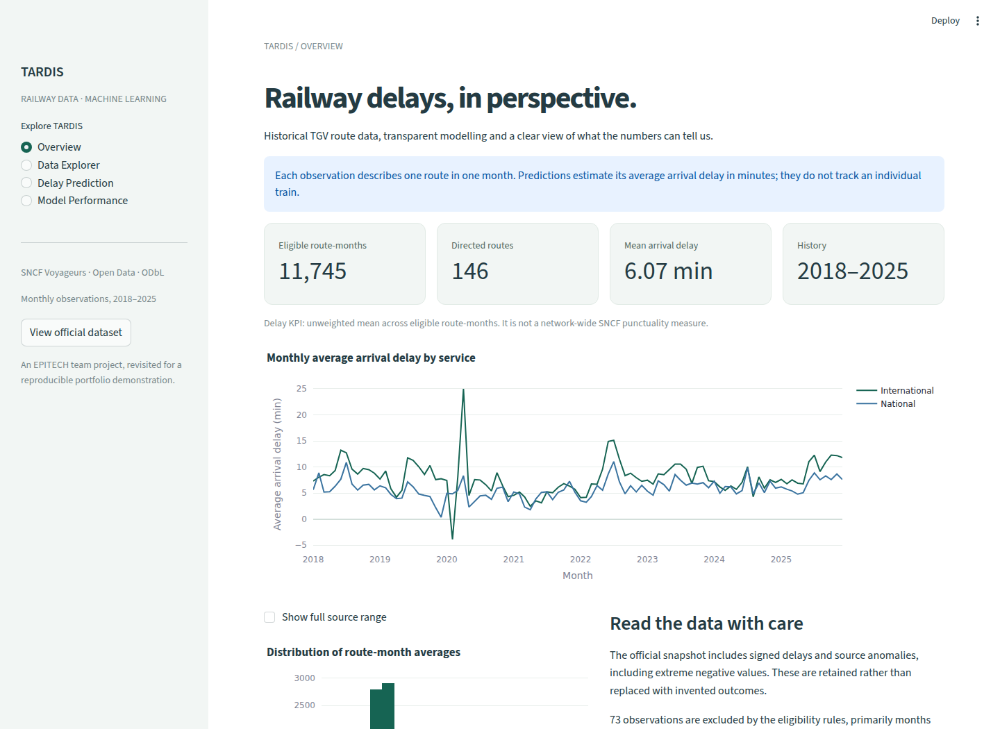

# TARDIS · Railway Insights

TARDIS explores historical SNCF railway data to analyse monthly arrival delays and compare reproducible forecasting methods through an interactive Streamlit dashboard.

Built from a **collective EPITECH project**, this edition archives the original notebooks and data outside the repository while introducing a verified official snapshot, chronological evaluation, a complete saved forecasting pipeline and a portfolio interface.

**Stack:** Python 3.12 · pandas · NumPy · scikit-learn · Streamlit · Plotly · joblib

- **GitHub repository:** [Tardis-Project](https://github.com/aitbenamaraabdelkader27/Tardis-Project). Personal origin verified locally; publication not performed.
- **Live Dashboard:** not deployed yet. Add the actual `https://<chosen-name>.streamlit.app` URL after an authorised deployment; this placeholder is not a live link.
- **Local dashboard:** `http://localhost:8501`



## What the application does

- **Overview:** data coverage, route-month KPIs, service trends and source-quality notes.
- **Data Explorer:** filter by year, service and stations; compare distributions, time series and departure stations; download filtered observations.
- **Delay Prediction:** replay a forecast for a known route and a month in 2025, using a pipeline fitted only through December 2024.
- **Model Performance:** inspect genuine validation/test results, baseline comparisons, observed-vs-predicted values and errors over time.

The target is **the monthly mean arrival delay for a directed route, in minutes**, across all trains in that observation. It is a regression task. It does not predict an individual train, a probability of delay or live operational conditions.

The selected model is a **historical route-mean baseline**: it beat Random Forest on the predeclared 2024 validation criterion. Its forecast is constant across months for a given route. Calendar effects are evaluated by the Random Forest candidate, but are not used by the selected baseline. This limitation is visible in the interface.

## Data and attribution

**Publisher:** SNCF Voyageurs. **Dataset:** [Régularité mensuelle TGV par liaisons (AQST)](https://ressources.data.sncf.com/explore/dataset/regularite-mensuelle-tgv-aqst/). **License:** [Open Database License (ODbL)](https://opendatacommons.org/licenses/odbl/1-0/).

The official CSV was downloaded on **16 October 2026**, restricted to January 2018–December 2025 and sorted deterministically. The versioned gzip snapshot contains **11,818 rows, 26 source columns**, and is approximately **735 KiB**. No sampling or synthetic observations are used. `data/source.json` records the exact download URL, source metadata, schema and SHA-256 of the uncompressed CSV.

Eligibility excludes 73 months with no operated trains, leaving **11,745 route-months**. There are no duplicate route-month keys or missing dates/route identities/targets in this snapshot. The source still contains **119 negative arrival averages**, including nine below −30 minutes, and **43 negative cells in a delay-count field**. Small negative averages can represent early arrival; extreme values remain unresolved source issues. Observed targets are never clipped, imputed or converted to zero. Auxiliary operational measurements are not model features.

All dashboard means weight route-months equally. As [SNCF explains](https://ressources.data.sncf.com/explore/dataset/regularite-mensuelle-tgv-aqst/), routes can overlap, so these observations must not be used to infer network-wide TGV regularity or distinct train totals. See [data provenance and dictionary](data/README.md).

## Reproducible methodology

1. Verify the snapshot checksum, parse its declared schema and normalise route names.
2. Apply predefined eligibility rules; keep the signed observed outcome.
3. Allow only **forecast month, service, departure station and arrival station** as inputs. Year and cyclical month encodings are derived inside the Random Forest pipeline.
4. Train candidates on **2018–2023** (8,801 rows). Select lowest MAE on **2024** (1,450 rows).
5. Refit each fixed candidate on **2018–2024** (10,251 rows); evaluate on untouched **2025** (1,494 rows).
6. Save the selected complete pipeline, its training-supported routes, exact test predictions and machine-readable scores.

Candidates: a global training-mean baseline; a route historical-mean baseline with a global fallback for unknown routes; and a Random Forest with 160 trees, maximum depth 14 and minimum leaf size 5, seed 42, one CPU thread. The forest reuses the original project's imputation + one-hot encoding pipeline, with numeric scaling and unknown-category handling. Encoders and imputers fit only on the relevant training partition.

Same-month duration, cancellations, delay counts and cause percentages are **excluded**: these are observed after operations, even when their names suggest planned information. There is no random train/test split, no target imputation and no test-driven hyperparameter search.

## Measured results

Scores below were computed by `python -m src.train` on the official snapshot. MAE and RMSE are in minutes per route-month. R² is dimensionless; negative scores are possible.

| Candidate | 2024 validation MAE | 2025 test MAE | 2025 test RMSE | 2025 test R² |
|---|---:|---:|---:|---:|
| Global mean | 2.653 | 3.202 | 4.498 | −0.111 |
| **Route historical mean · selected** | **2.194** | **2.686** | **3.795** | **0.209** |
| Random Forest | 2.496 | 2.569 | 3.647 | 0.269 |

Random Forest performs better on the final test year, but was not selected because the selection rule was locked using validation. The deployed artifact reduces test MAE by about **16.1%** relative to the global mean. This is modest evidence for an aggregate historical demonstration, not a guarantee of future operational accuracy.

There are 48 test route-months whose routes were absent from training; the route baseline uses its training global mean for them. The interactive form deliberately offers only training-supported routes. The saved artifact is about **2.7 KB**, so no retraining or model downloads occur when visiting the dashboard.

Full evidence: [metrics](reports/metrics.json), [held-out predictions](reports/predictions.csv), [audit](docs/AUDIT.md) and [validation record](docs/VALIDATION.md). Original reports in `docs/EDA_INSIGHTS.md`, `docs/MODEL_REPORT.md` and `docs/DATA_DICTIONNARY.md` describe the student version and are not current metrics.

## Local installation

Use **Python 3.12**. From the repository root:

```bash
python3.12 -m venv .venv
source .venv/bin/activate
python -m pip install -r requirements.txt
python -m streamlit run tardis_dashboard.py
```

On Windows, activate using `.venv\Scripts\Activate.ps1`. The versioned data and saved model are sufficient for startup; no API key, secrets or training are required. Paths are resolved relative to source files rather than your machine. Only load trusted joblib artifacts from this repository.

To inspect the source data and reproduce training:

```bash
python -m src.data_checks
python -m src.train
python -m unittest discover -s tests -v
```

The training command replaces the demonstration model, report, supported routes and predictions together. Direct dependencies are pinned in `requirements.txt`, with the tested transitive versions constrained by `requirements.lock.txt`. Artifacts verify matching model package versions and checksums. A second training run was checked for identical metrics and predictions.

Optional notebook tools are in `requirements-dev.txt`. The original notebooks are archived outside this repository as historical work and can contain obsolete paths and modelling choices; use the modules above for the supported pipeline.

To refresh from SNCF, explicitly run:

```bash
python scripts/fetch_data.py
python -m src.train
python -m unittest discover -s tests -v
```

Refreshing is a maintenance action: the official endpoint may revise historical records. Git-version the new snapshot, manifest, model, predictions and report together and update the published results. The committed snapshot is the source of exact reproduction; an evolving API cannot guarantee byte-identical future downloads.

## Streamlit Community Cloud

See the [precise deployment procedure](docs/DEPLOYMENT.md). Publication and deployment have **not** been performed.

1. Confirm permission to redistribute collective code and EPITECH-related material.
2. Review the staged files in this personal repository. Historical coursework is backed up outside the repository. Optionally use `python scripts/prepare_public_release.py --output /tmp/tardis-public-reviewed` for a fresh allowlisted export; existing destinations are refused.
3. Commit and push to the existing personal origin **only after explicit authorisation**.
4. In [Streamlit Community Cloud](https://share.streamlit.io/), create an app, choose that repository and branch, set the main file to `tardis_dashboard.py`, and select Python **3.12** in Advanced settings. Leave secrets empty.
5. Deploy only after authorisation, check all four pages, then add the actual repository and live URLs to the README and `portfolio.json`.

Runtime data and model together are under 1 MB. They are loaded once per Streamlit process and cached. No background training, paid API, local filesystem dependency or network data fetch is needed. Hosting availability and resource limits remain subject to Streamlit's service.

## Structure

```text
tardis_dashboard.py       Streamlit entry point
src/                     Data contract, features, training, inference, evaluation
app/components/          Plot formatting and pure filtering helpers
data/sncf_2018_2025.csv.gz Official bounded snapshot
data/source.json         Source, license, schema and checksum
models/forecast.joblib    Selected complete forecasting pipeline
models/routes.csv        Training-supported route choices
reports/                 Measured scores and full held-out predictions
scripts/                 Official download and public-release preparation
tests/                   Data, pipeline and Streamlit application checks
.streamlit/config.toml   Light theme and runtime settings
docs/                    Audit, deployment, validation and screenshots
portfolio.json           Honest project metadata and publication status
```

Original CSVs, notebooks, the large historical model and legacy documentation are preserved outside this repository in the local backup recorded in [the cleanup audit](docs/CLEANUP.md). The nested EPITECH repository and its history are backed up intact. Useful refactor files and personal notebook changes were preserved; the supported runtime uses only the official snapshot and current artifacts.

## Limits and next steps

- Monthly aggregates cannot predict a specific departure or unexpected incident. The demo is intentionally frozen to 2025; it is not a live forecasting product.
- Source anomalies are preserved and can distort averages, learned route histories and regression metrics. Domain review and a predeclared sensitivity analysis are needed before operational use.
- The selected simple baseline ignores seasonality; Random Forest validation/test ranking changes across years. Rolling chronological backtests are a priority before changing the selection rule.
- The test covers only one year. No calibrated uncertainty intervals or causal explanations are provided.
- Unknown routes have baseline fallbacks in evaluation but are excluded from the user form. Station names and international services change over time.
- The original coursework was produced collectively. Team contributions have not been reconstructed; this README does not attribute the team's work to one person. This refactor's scope is recorded in the audit and portfolio metadata; personal authorship claims require owner review.
- No blanket software license has been applied to collective code. Confirm rights and choose an appropriate code license before publication. SNCF data attribution and ODbL terms apply separately; see [third-party notices](THIRD_PARTY_NOTICES.md).
